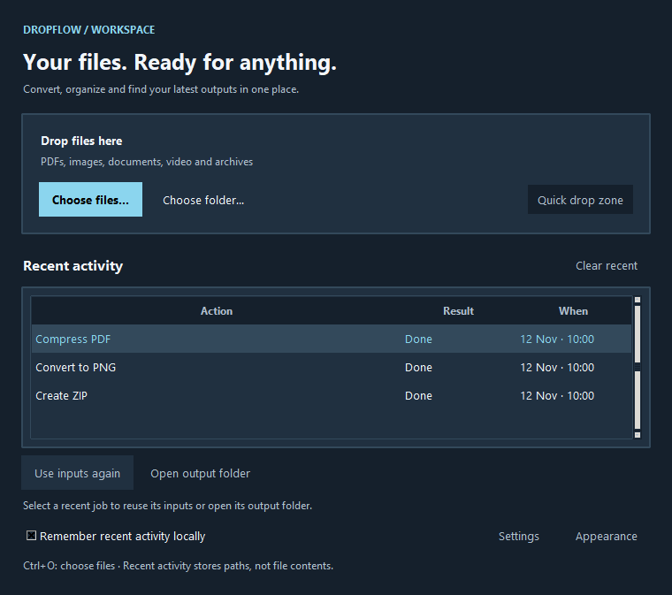
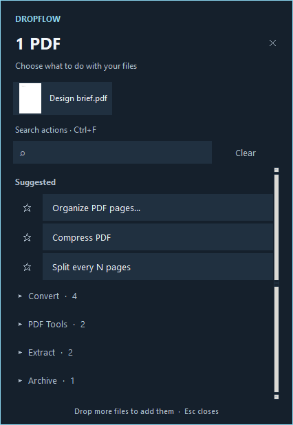
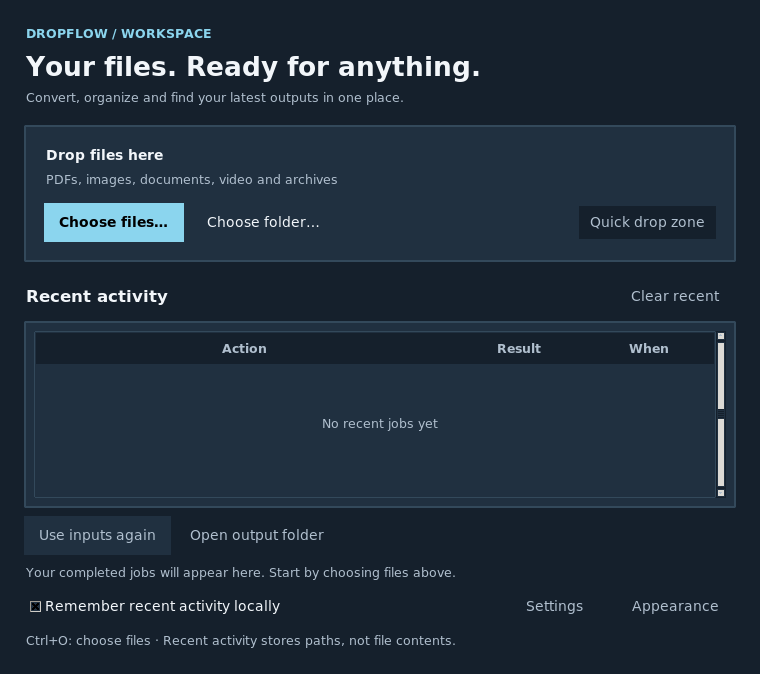

# DropFlow

**Version 3.4.0** · Windows 10/11 x64 and Linux x86_64 · Python 3.10+ (3.12 recommended)

Drop files into the workspace to convert documents, organize PDFs, process images and media, or create archives. Files stay on your computer.

[](https://github.com/eyadjamal/dropflow/releases/download/v3.4.0/DropFlow-Setup-3.4.0.exe)
[](https://github.com/eyadjamal/dropflow/releases/download/v3.4.0/DropFlow-3.4.0-Linux-x86_64.tar.gz)

[Portable Windows ZIP](https://github.com/eyadjamal/dropflow/releases/download/v3.4.0/DropFlow-3.4.0-Portable.zip) · [Source code](https://github.com/eyadjamal/dropflow/archive/refs/tags/v3.4.0.zip) · [Release notes](https://github.com/eyadjamal/dropflow/releases/tag/v3.4.0)

On Windows, run the installer or extract the entire portable ZIP. On Linux, extract the binary archive and run `./DropFlow/DropFlow --workspace` from its parent directory. The Linux build targets x86_64 graphical desktops with glibc 2.36 or newer and X11 or XWayland. See [Linux setup and optional conversion tools](LINUX.md).

## What's new in 3.4.0

- **Shared workspace:** one home for Windows and Linux, with file/folder selection, the quick drop zone and recent jobs. Open it from the tray or launch with `--workspace`. It appears on first launch; Windows shortcuts open it directly.
- **Recent activity:** the latest 15 jobs, reusable input selections and quick output-folder access. Activity stores paths and result counts locally, without document contents or conversion passwords. Disable recording or clear the list from the workspace.
- **Smarter search:** intent words such as “shrink PDF” and “combine,” English/Arabic labels, a short input debounce, Ctrl+F, arrow navigation and Enter to review the first action. New users see Suggested actions until usage is available.
- **Smoother previews:** bounded, cached thumbnails render on a background worker. Stale previews cannot replace a new selection and preview tasks stop when their window closes.
- **Clearer results:** live completed/failed/queued counts, stable result details, meaningful failure/cancellation headings, and shortcuts to another action or the workspace.
- **Appearance and controls:** shared dark/light cards, cleaner tables, empty states, fonts chosen for the platform and Linux mouse-wheel scrolling in action/output screens.

- **Windows appearance:** the workspace and quick drop zone can show live blurred content on supported Windows 11 desktops. The Midnight palette now uses blue accents. Workspace buttons follow the pointer with a soft highlight, and the workspace fades in when opened. Windows transparency and animation settings are respected.

### Linux support

- **Linux support:** a desktop control window, file/folder selection, optional drag and drop and tray support.
- **Desktop integration:** per-user installation, application launcher, autostart, and optional Nautilus/Dolphin actions.
- **Portable runtime:** Linux process cancellation, output opening, fonts and XDG configuration paths; Windows integration retained.
- **Shortcuts:** optional X11 global shortcut; on Wayland, configure your desktop shortcut to `dropflow --toggle`.
- **Cross-platform checks:** Windows and Ubuntu CI, unit tests and native Tk conversion/retry/organizer smoke tests.

See [Linux installation and compatibility](LINUX.md). Linux packaging targets x86_64; desktop tray and global shortcut availability depend on the desktop environment.

## Features

- **Smarter menu:** applicable favorites and three frequently used actions first; other actions grouped under Convert, PDF Tools, Extract and Archive. Search reveals matching groups.
- **Quality presets:** Small file, Balanced and Best quality, with advanced parameters available separately.
- **Per-file results:** live status, output paths, readable failures and Retry failed files. Combined operations retry the complete ordered job.
- **Saved presets:** named conversion settings, destination folders and filename patterns. Load from the menu; update or delete from output review.
- **Output controls:** destination selection, filename preview using `{name}`, `{action}`, `{index}` and `{date}`, numbered collision protection, and per-result Open file, Open folder and Copy path.
- **Visual PDF organizer:** drag thumbnails to reorder, rotate/delete pages, add PDFs, undo and preview. Saves a new document and preserves the originals.
- **Refreshed appearance/UI:** refined Midnight and Light themes, readable typography, consistent cards and controls, clear primary actions, numbered page cards, rotation badges and keyboard-aware scrolling.
- **English and Arabic:** translated controls and RTL form labels; display scaling checked at 100–150%.
## Screenshots

The Windows 3.4.0 workspace with sample activity, followed by the action menu for a sample PDF.





The Linux workspace on Debian 12 with an empty job history.



## Conversion tools

| Input | Tasks |
| --- | --- |
| PDF | Organize, merge, compress, split, extract ranges, export pages, OCR/searchable PDF and text |
| Images | PNG/JPG/WebP conversion, compression, PDF creation, OCR and animated GIF from multiple images |
| Word, PowerPoint, Excel | PDF, slide images, text and supported data/document conversions |
| TXT, CSV, JSON | Supported PDF/document/spreadsheet conversions |
| Video/audio | Media conversion, compression and audio extraction through FFmpeg |
| ZIP/RAR, files/folders | ZIP creation and supported archive extraction, including password prompts |

Image inputs: PNG, JPG/JPEG, WebP, BMP, TIFF and GIF. Archiving arbitrary files is separate from image conversion. Optional helpers affect operation availability and layout fidelity.

## Run from source

```powershell
python -m pip install -r requirements.txt
python DropFlow.pyw --console
```

Use 64-bit Python 3.12 on Windows and keep the Python modules together. Configuration, presets, recent path references and logs are stored in `%APPDATA%\DropFlow`.

## Linux source installation

Extract the Linux source package, then run as your normal desktop user:

```bash
sudo apt install python3-tk python3-venv libxcursor1 xdg-utils
sh linux/install.sh
```

Open **DropFlow** from the applications menu. The installer creates an isolated Python environment and downloads its dependencies. See [LINUX.md](LINUX.md) for the portable executable, optional helpers and Wayland notes.

## Windows builds

Use the setup supplied for the desired release, or extract the entire portable ZIP and run `DropFlow.exe`. Python is bundled; keep `_internal` beside the executable. Quit an older running instance before installing. Current builds are unsigned.

The public setup installs per user and provides the classic Explorer **Send to DropFlow** entry. The separate development-only modern context-menu package is not included in that public build.

## Optional helpers

- **LibreOffice:** preferred Office-to-PDF/slide rendering and legacy Office files. Microsoft Office COM is a fallback with installed Office and pywin32.
- **Tesseract:** OCR; install the English/Arabic language data you need.
- **7-Zip or UnRAR:** RAR and supported encrypted archive cases.
- **FFmpeg:** bundled through imageio-ffmpeg.

## PDF organizer

Drop PDFs and choose **Organize PDF pages**. Drag cards, use the editing toolbar and select a page for a larger preview. Large documents show 24 thumbnails per group; Move left/right can cross groups. Undo keeps the last 50 changes. Save PDF opens output review. Unlock password-protected PDFs first. Rebuilding selected pages does not preserve document-level bookmarks/forms as a complete original document structure.

## Development

```powershell
python -m unittest discover -s tests -v
python DropFlow.pyw --selftest --console
```

See [DEVELOPMENT.md](DEVELOPMENT.md), [ARCHITECTURE.md](ARCHITECTURE.md), [DESIGN.md](DESIGN.md) and [CHANGELOG.md](CHANGELOG.md). CI runs unit tests and native Tk smoke checks on Windows and Ubuntu.

## Privacy and license

Conversions run locally. The optional update checker contacts the GitHub releases API. No document upload, telemetry or account is required. Recent activity is stored locally in configuration and can be disabled or cleared. Clearing activity does not delete input or output files.

Source is licensed under [AGPL-3.0](LICENSE). See [third-party notices](THIRD_PARTY_NOTICES.txt).
