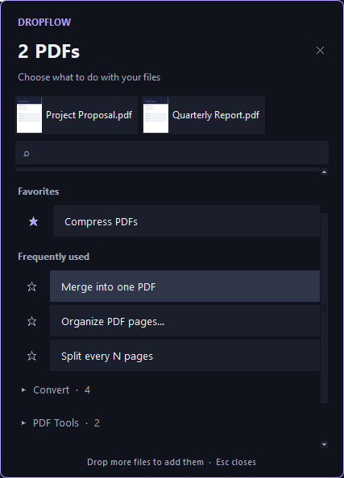
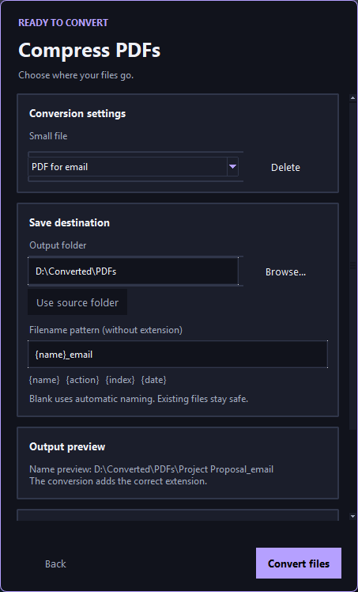
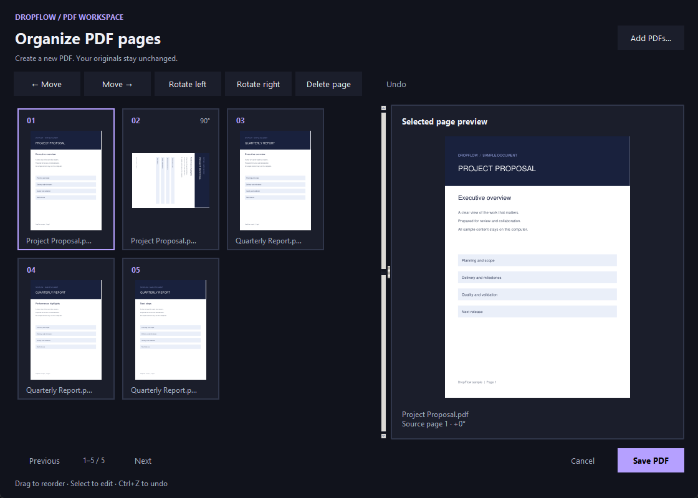
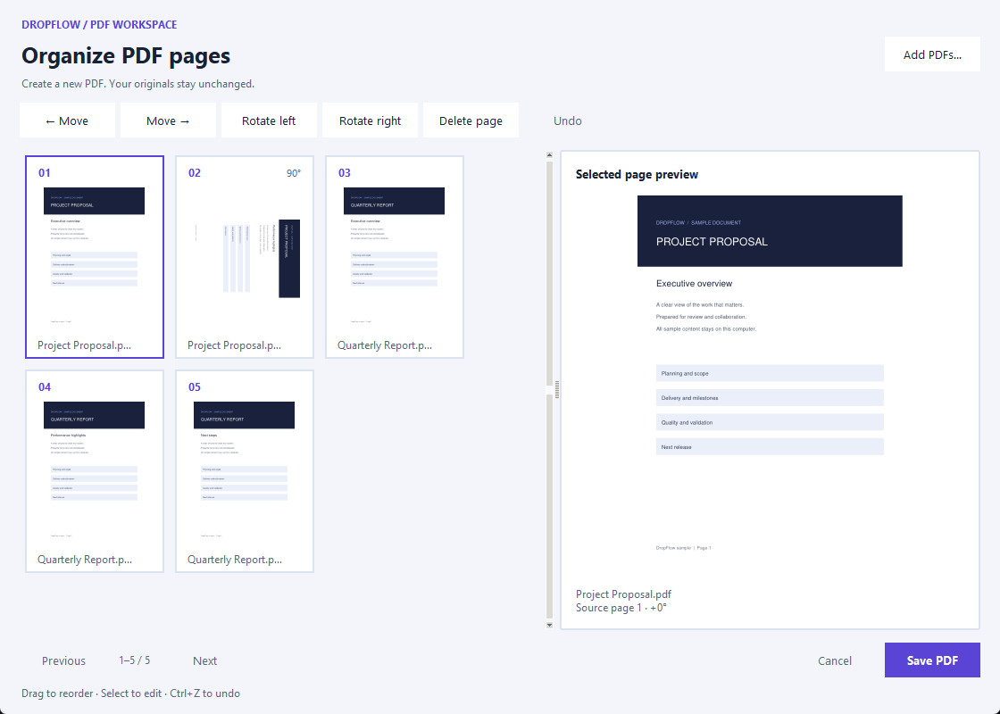

# DropFlow

**Version 3.3.0** · Windows 10/11 x64 · Python 3.12

### Drop it. Convert it. Done.

A local Windows tray utility for PDF, Office, image, archive, video and audio tasks. Drop files, choose an action, review the destination, and convert. No account, uploads or telemetry.

[](https://github.com/eyadjamal/dropflow/actions/workflows/tests.yml)
[Download source ZIP](https://github.com/eyadjamal/dropflow/archive/refs/heads/main.zip) · [Published Windows releases](https://github.com/eyadjamal/dropflow/releases)

This branch contains **3.3.0** source and build configuration. Existing release downloads retain the version in their release title; updating the branch does not replace older release assets.

## What's new in 3.3.0

- **Smarter menu:** applicable favorites and three frequently used actions first; other actions grouped under Convert, PDF Tools, Extract and Archive. Search reveals matching groups.
- **Quality presets:** Small file, Balanced and Best quality, with advanced parameters available separately.
- **Per-file results:** live status, output paths, readable failures and Retry failed files. Combined operations retry the complete ordered job.
- **Saved presets:** named conversion settings, destination folders and filename patterns. Load from the menu; update or delete from output review.
- **Output controls:** destination selection, filename preview using `{name}`, `{action}`, `{index}` and `{date}`, numbered collision protection, and per-result Open file, Open folder and Copy path.
- **Visual PDF organizer:** drag thumbnails to reorder, rotate/delete pages, add PDFs, undo and preview. Saves a new document and preserves the originals.
- **Refreshed appearance/UI:** refined Midnight and Light themes, readable typography, consistent cards and controls, clear primary actions, numbered page cards, rotation badges and keyboard-aware scrolling.
- **English and Arabic:** translated controls and RTL form labels; display scaling checked at 100–150%.
- **Maintainability:** separate modules for menu ranking, quality presets, jobs, presets, output policy, output review, PDF models, organizer UI and styling.

## Screenshots

These screenshots use sample documents.

### Action menu


### Presets and output review


### PDF organizer — dark


### PDF organizer — light


## Conversion tools

| Input | Tasks |
| --- | --- |
| PDF | Organize, merge, compress, split, extract ranges, export pages, OCR/searchable PDF and text |
| Images | PNG/JPG/WebP conversion, compression, PDF creation, OCR and animated GIF from multiple images |
| Word, PowerPoint, Excel | PDF, slide images, text and supported data/document conversions |
| TXT, CSV, JSON | Supported PDF/document/spreadsheet conversions |
| Video/audio | Media conversion, compression and audio extraction through FFmpeg |
| ZIP/RAR, files/folders | ZIP creation and supported archive extraction, including password prompts |

Image inputs: PNG, JPG/JPEG, WebP, BMP, TIFF and GIF. HEIC/HEIF image files are unsupported. Archiving arbitrary files is separate from image conversion. Optional helpers affect operation availability and layout fidelity.

## Run from source

```powershell
python -m pip install -r requirements.txt
python DropFlow.pyw --console
```

Use 64-bit Python 3.12 on Windows and keep the Python modules together. Configuration, presets and logs are stored in `%APPDATA%\DropFlow`.

## Windows builds

Use the setup supplied for the desired release, or extract the entire portable ZIP and run `DropFlow.exe`. Python is bundled; keep `_internal` beside the executable. Quit an older running instance before installing. Current builds are unsigned.

The public setup installs per user and provides the classic Explorer **Send to DropFlow** entry. The separate development-only modern context-menu package is not included in that public build.

## Optional helpers

- **LibreOffice:** preferred Office-to-PDF/slide rendering and legacy Office files. Microsoft Office COM is a fallback with installed Office and pywin32.
- **Tesseract:** OCR; install the English/Arabic language data you need.
- **7-Zip or UnRAR:** RAR and supported encrypted archive cases.
- **FFmpeg:** bundled through imageio-ffmpeg. Its video/audio codecs are independent of the removed image support.

## PDF organizer

Drop PDFs and choose **Organize PDF pages**. Drag cards, use the editing toolbar and select a page for a larger preview. Large documents show 24 thumbnails per group; Move left/right can cross groups. Undo keeps the last 50 changes. Save PDF opens output review. Unlock password-protected PDFs first. Rebuilding selected pages does not preserve document-level bookmarks/forms as a complete original document structure.

## Development

```powershell
python -m unittest discover -s tests -v
python DropFlow.pyw --selftest --console
```

See [DEVELOPMENT.md](DEVELOPMENT.md), [ARCHITECTURE.md](ARCHITECTURE.md), [DESIGN.md](DESIGN.md) and [CHANGELOG.md](CHANGELOG.md). Windows CI installs requirements, compiles the source and runs tests.

## Privacy and license

Conversions run locally. The optional update checker contacts the GitHub releases API. No document upload, telemetry or account is required.

Source is licensed under [AGPL-3.0](LICENSE). See [third-party notices](THIRD_PARTY_NOTICES.txt).
