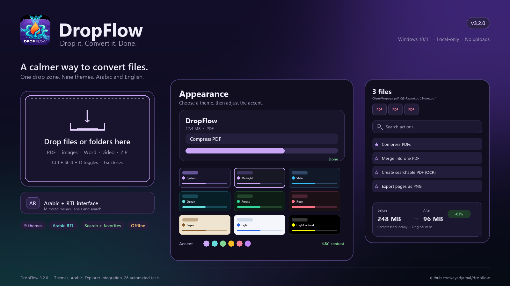

# DropFlow
Version 3.2.0

### Drop it. Convert it. Done.


DropFlow is a local, drag-and-drop Windows file toolbox for PDFs, Office
files, images, archives, video, and audio. Drop files onto the window, pick a
task, and the result is created beside the original file.

No cloud. No telemetry. No account required.

[](https://github.com/eyadjamal/dropflow/releases/latest/download/DropFlow-Setup.exe)


## Features

### Conversion
- PDF merge, compress, split, page ranges, export, OCR, searchable PDFs
- PowerPoint `.pptx` / `.ppt` → PDF, PNG/JPG slides, TXT
- Excel `.xlsx` / `.xls` → PDF, CSV, HTML, JSON, TXT
- TXT → PDF, DOCX, PPTX, XLSX
- Images/PDF → PowerPoint
- CSV/JSON/PDF → Excel workbook
- ZIP/RAR extraction with password prompts
- Universal Media Converter
- Video compression and audio extraction

### Interface
- Draggable floating window with remembered position
- 9 themes: System, Midnight, Slate, Ocean, Forest, Rose, Sepia, Light, High Contrast
- Custom accent color with contrast guard
- Reduce Motion
- Arabic and English interface with RTL alignment
- Searchable actions and favorites
- Image/PDF thumbnails
- Before/after result card
- Batch progress with recent activity
- Classic Explorer context menu

### Privacy
- Fully local processing
- No uploads
- No telemetry
- Optional update checker only

## Download and run

1. Download **`DropFlow-Setup.exe`** from the latest release.
2. Run the installer and follow the wizard.
3. Run **`DropFlow.exe`**.
4. Keep `DropFlow.exe` and the `_internal` folder together.

Python is **not** required.

### Direct download

[Download DropFlow for Windows](https://github.com/eyadjamal/dropflow/releases/latest/download/DropFlow-Setup.exe)

### Portable version

[Download DropFlow-Windows.zip](https://github.com/eyadjamal/dropflow/releases/latest/download/DropFlow-Windows.zip)

## ⚠️ SmartScreen warning

This build is **not code-signed**, so Windows may display:

> Windows protected your PC

This is expected for an unsigned independent application. Click:

**More info → Run anyway**

DropFlow runs entirely on your machine.

## Optional tools

DropFlow detects these automatically:

- **LibreOffice** — best-quality Office → PDF and legacy `.ppt`/`.xls`
- **Tesseract** — OCR and image → text
- **UnRAR or 7-Zip** — RAR extraction

Without LibreOffice, text/CSV/JSON/HTML conversions still work, but
PowerPoint/Excel → PDF may have reduced layout fidelity.

## Privacy

Everything runs locally. There is no upload, telemetry, or account requirement.

## Requirements

- Windows 10/11 64-bit
- Python is not required for the installer
- Optional: LibreOffice, Tesseract, UnRAR/7-Zip

## License

GNU Affero General Public License v3.0 — see [LICENSE](LICENSE).

## Source layout

```text
DropFlow.pyw
appearance.py
i18n.py
app_update.py
media_converter.py
office_converter.py
tests/
.github/workflows/tests.yml
