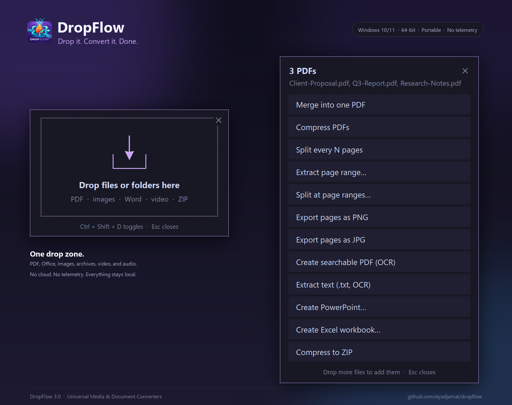

# DropFlow
Version 3.2.0

### Drop it. Convert it. Done.


DropFlow is a local, drag-and-drop Windows file toolbox for PDFs, Office
files, images, archives, video, and audio. Drop files onto the window, pick a
task, and the result is created beside the original file.

No cloud. No telemetry. No account required.

[](https://github.com/eyadjamal/dropflow/releases/latest/download/DropFlow-Setup.exe)

## Features

- PDF merge, compress, split, page ranges, export, OCR, and searchable PDFs
- PowerPoint `.pptx` / `.ppt` → PDF, PNG/JPG slides, or TXT
- Excel `.xlsx` / `.xls` → PDF, CSV, HTML, JSON, or TXT
- TXT → PDF, DOCX, PPTX, or XLSX
- Images/PDF → PowerPoint presentation
- CSV/JSON/PDF → Excel workbook
- PDF/DOCX/PPTX/XLSX/images → TXT
- ZIP/RAR extraction with password prompts
- Universal Media Converter for video, audio, and GIF
- Video compression with resolution, target-size, and GPU options
- Audio extraction
- Tray icon and native global hotkey
- Batch processing with per-file error handling
- Draggable floating window
- New appearance features
- Theme list
- Arabic/RTL support
- Installer download button
- Portable ZIP option
- SmartScreen warning
- Offline/local processing note
- Classic Explorer menu note
- Modern-menu development status

## Download and run

1. Download **`DropFlow-Setup.exe`** from the latest release.
2. Run the installer and follow the wizard.
3. Run **`DropFlow.exe`**.
4. Keep `DropFlow.exe` and the `_internal` folder together.

Python is **not** required.

### Direct download

[Download DropFlow for Windows](https://github.com/eyadjamal/dropflow/releases/latest/download/DropFlow-Setup.exe)

## ⚠️ SmartScreen warning

This build is **not code-signed**, so Windows may display:

> Windows protected your PC

This is expected for an unsigned independent application. Click:

**More info → Run anyway**

DropFlow runs entirely on your machine.

## Optional tools

DropFlow detects these automatically:

- **LibreOffice** — best-quality Office → PDF and legacy `.ppt`/`.xls`
- **Tesseract** — OCR and image → text
- **UnRAR or 7-Zip** — RAR extraction

Without LibreOffice, text/CSV/JSON/HTML conversions still work, but
PowerPoint/Excel → PDF may have reduced layout fidelity.

## Privacy

Everything runs locally. There is no upload, telemetry, or account requirement.

## Source layout

```text
DropFlow.pyw          Application, UI, and actions
media_converter.py    Video/audio/GIF conversion
office_converter.py   PowerPoint/Excel/Word/text conversion
requirements.txt      Python dependencies
DEVELOPMENT.md        Architecture and integration notes
